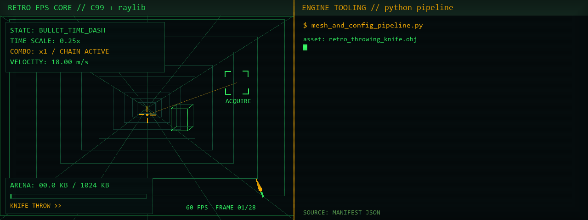
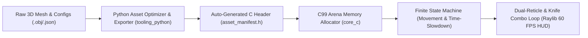

# Retro FPS Engine & Tooling

A C99 movement and combat prototype paired with a Python asset optimization pipeline for a memory-conscious retro FPS workflow.




This project connects offline mesh processing to a small, explicit C runtime. Python validates and simplifies asset geometry, then exports a manifest consumed by the runtime. The C prototype combines arena allocation, movement states, scaled simulation time, target locking, and a knife combo loop. The animated demonstration above is a Pillow-rendered simulation of the HUD and pipeline log, rather than a recording of the raylib application; it uses real pipeline results when the generated JSON manifest is available.

## Architecture



The movement FSM uses `STATE_GROUND_MOVE`, `STATE_BUNNY_HOP`, `STATE_DASH`, and `STATE_BULLET_TIME_AIR`. The demo's `BULLET_TIME_DASH` label describes its visual sequence; it is not an additional runtime FSM state.

## Modules

| Module | Responsibility |
| --- | --- |
| `core_c/include/rf_math.h` | Header-only `RfVec2` / `RfVec3` math so the core compiles and tests without raylib. |
| `core_c/include/memory_arena.h` | Fixed-size arena exposing `arena_init`, `arena_alloc`, and `arena_reset`, avoiding per-frame `malloc` / `free`. |
| `core_c/include/state_machine.h` | Four-state movement FSM integrating velocity, acceleration, and friction with `delta_time * time_scale`. |
| `core_c/include/combat_combo.h` | Dual-reticle lock-on coordinates and knife throw chains using `combo_multiplier`, `combo_timer`, and `knife_recall_state`; combo-triggered bullet time sets `time_scale = 0.25f`. |
| `core_c/include/asset_manifest.h` | Auto-generated asset metadata connecting optimized content to the C runtime. |
| `core_c/src/main_prototype.c` | Raylib loop targeting 60 FPS with HUD rendering; a `HEADLESS_TEST` build runs 60 frames of physics/state telemetry without raylib. |
| `tooling_python/mesh_and_config_pipeline.py` | OBJ parsing, topology checks, cleanup, PS1-style vertex snapping, simplification, and pipeline reporting. |
| `tooling_python/engine_exporter.py` | Exports a C99 header, JSON manifest, Unreal DataTable CSV, and Unity C# asset data. |
| `core_c/tests/test_core.c` | Framework-free C unit tests for the arena, FSM transitions, time scaling, dual reticle, combo chain, and knife recall. |
| `generate_demo_gif.py` | Deterministic split-screen CRT animation using Pillow and Rich, with manifest-aware logs and automatic GIF verification. |

## Quick Start

```sh
git clone https://github.com/mirzatheduck/retro-fps-engine-and-tooling.git
cd retro-fps-engine-and-tooling
```

Run commands from the project root. Python 3.12 is the reference interpreter; the interactive C prototype requires a graphics-capable environment.

1. Install the Python dependencies, generate asset exports, and run the pipeline tests:

   ```sh
   python -m pip install -r requirements.txt
   python tooling_python/mesh_and_config_pipeline.py
   python -m unittest discover -s tooling_python/tests -v
   ```

2. Create the output directory (`mkdir -p build` in a POSIX shell, or `if not exist build mkdir build` in a Windows Command Prompt). Build and run the C headless test with GCC:

   ```sh
   gcc -std=c99 -Wall -Wextra -O2 -DHEADLESS_TEST -Icore_c/include core_c/src/*.c -o build/headless_test -lm
   ./build/headless_test
   ```

   Alternatively, use `make test`. With MSVC, use a Developer Command Prompt:

   ```bat
   cl /std:c11 /W4 /DHEADLESS_TEST /Icore_c\include core_c\src\*.c /Fe:build\headless_test.exe
   build\headless_test.exe
   ```

3. Build and test with CMake:

   ```sh
   cmake -S . -B build -DHEADLESS_TEST=ON && cmake --build build && ctest --test-dir build
   ```

   For the interactive application, configure with raylib enabled. This configuration fetches raylib using FetchContent and requires network access on the first configure:

   ```sh
   cmake -S . -B build -DHEADLESS_TEST=OFF
   cmake --build build
   ./build/retro_fps_prototype
   ```

   Multi-configuration generators such as Visual Studio place the executable in a configuration subdirectory, for example `build\Debug\retro_fps_prototype.exe`.

4. Regenerate the demonstration after running the asset pipeline:

   ```sh
   python generate_demo_gif.py
   ```

   Defaults are 28 frames, 1280 × 480 pixels, and 250 ms per frame, totaling 7 seconds with infinite looping. Optional arguments are `--out`, `--frames`, and `--ms`; GIF timing requires a multiple of 10 ms. If the manifest is absent, the console and animation identify the fallback simulation.

5. Use the Make targets to run individual stages or the complete workflow:

   ```sh
   make tooling
   make test
   make gif
   make all
   ```

## Project Structure

```text
retro-fps-engine-and-tooling/
├── .gitignore
├── Makefile                          # tooling / test / prototype / gif targets
├── CMakeLists.txt                    # retro_core lib, ctest, optional raylib prototype
├── requirements.txt                  # rich, Pillow
├── generate_demo_gif.py              # split-screen HUD + pipeline GIF generator
├── assets/
│   └── demo.gif
├── core_c/
│   ├── include/
│   │   ├── rf_math.h                 # header-only vector math (no raylib dependency)
│   │   ├── memory_arena.h
│   │   ├── state_machine.h
│   │   ├── combat_combo.h
│   │   └── asset_manifest.h          # generated by the Python pipeline
│   ├── src/
│   │   ├── memory_arena.c
│   │   ├── state_machine.c
│   │   ├── combat_combo.c
│   │   └── main_prototype.c          # raylib loop + HEADLESS_TEST telemetry
│   └── tests/
│       └── test_core.c               # arena / FSM / reticle / combo unit tests
└── tooling_python/
    ├── mesh_and_config_pipeline.py
    ├── engine_exporter.py
    ├── sample_assets/
    │   ├── generate_knife_obj.py     # procedural 14,200-triangle knife
    │   └── retro_throwing_knife.obj
    ├── output/                       # JSON, Unreal CSV, Unity C#, low-poly OBJ
    └── tests/
        └── test_pipeline.py
```

## Verified Results

Numbers below come from the generated pipeline output (`tooling_python/output/asset_manifest.json`) and test runs; they are regenerated, not hand-written.

| Check | Result |
| --- | --- |
| Mesh pipeline, `retro_throwing_knife.obj` | 14,200 -> 480 triangles, 7,206 -> 239 vertices |
| Source topology defects detected | 3 duplicate vertices, 3 degenerate faces, 1 non-manifold edge |
| Estimated vertex + index buffer size | 315,792 -> 10,528 bytes (96.7% saved) |
| Engine compatibility score | 86 / 100 (7 non-manifold edges remain after clustering) |
| Python unit tests | 9 passed |
| C unit tests (`core_c/tests/test_core.c`) | 92 checks, 0 failures (MSVC `/W4 /WX`) |
| `HEADLESS_TEST` 60-frame telemetry | all four FSM states visited, x3 combo triggers 0.25x bullet time, 0 failed arena allocations |
| CMake / ctest | `core_unit_tests` and `headless_telemetry` pass; raylib prototype target builds |

## Prototype Controls

| Input | Action |
| --- | --- |
| `W A S D` | Move |
| `Space` (hold) | Jump; holding through landings chains bunny hops (+10% speed per hop, capped) |
| `Left Shift` | Dash (0.18 s burst, 0.6 s cooldown) |
| Left mouse | Throw knife at the secondary reticle's target (assisted aim) |
| Right mouse | Recall knife; the returning blade can hit targets on its way back |
| `E` (hold, airborne) | Manual bullet-time air state |

## Design Notes

- An arena provides predictable allocation cost and a bounded memory budget. Resetting transient storage together keeps allocation and ownership simple inside the game loop.
- Applying `time_scale` to the FSM timestep keeps velocity, acceleration, and friction on the same simulation clock during bullet time.
- PS1-style vertex snapping quantizes geometry for a deliberately coarse visual language. Topology checks and cleanup support a usable mesh after simplification.
- The generated header is the single source of truth for asset metadata shared between tooling and the runtime. Regenerate it from source assets rather than editing it manually.

## License

MIT. See [LICENSE](LICENSE).
